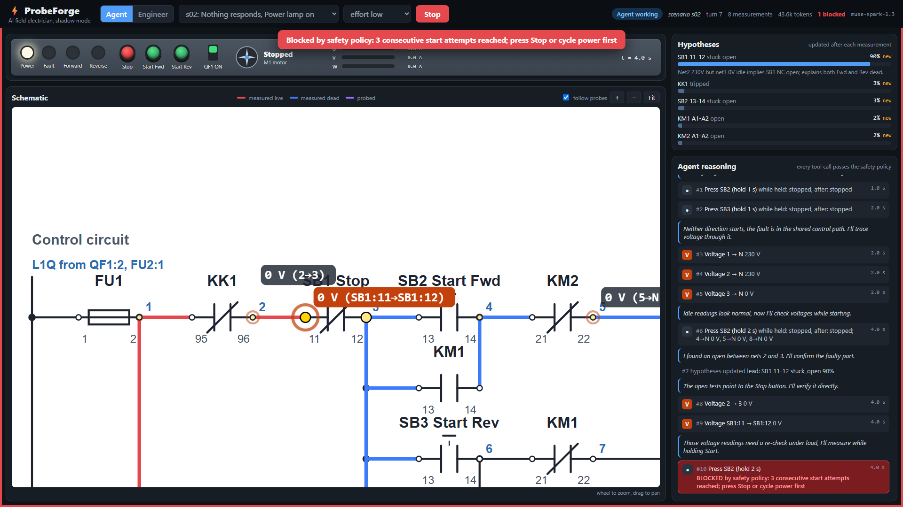
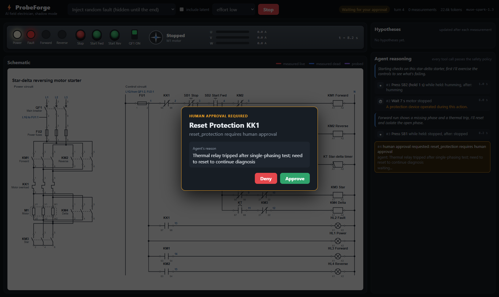
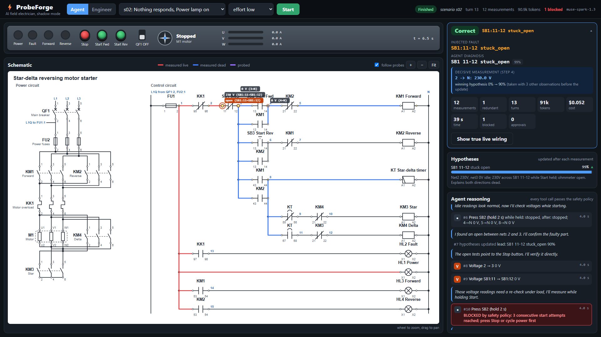
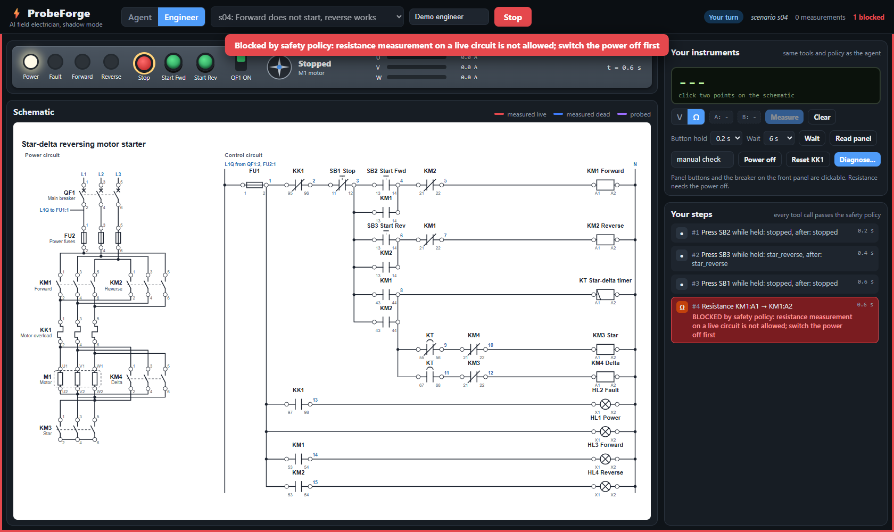
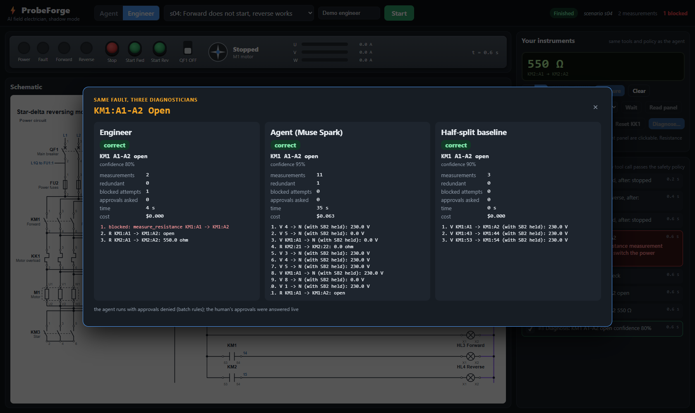
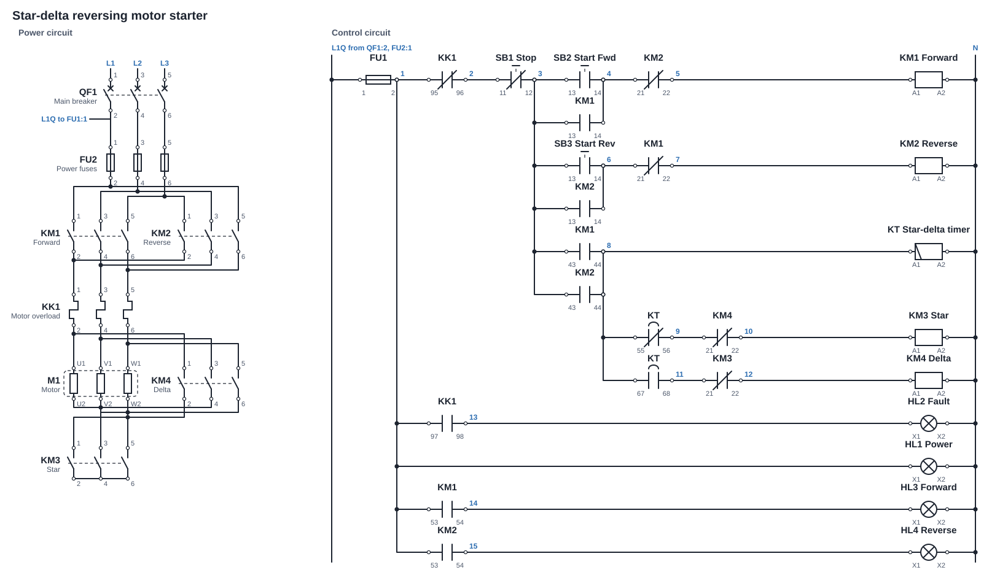

# ProbeForge

AI agent that diagnoses faults in an industrial relay-contactor circuit (star-delta reversing motor starter) by choosing its own virtual measurements, under hard safety limits enforced in code. Built for the Meta Global AI Developer Hackathon 2026.

Status: Day 4. Simulator, faults, tools, safety policy, Muse Spark agent, half-split baseline, evaluation harness (clean holdout results) and the live web UI are done and tested.

## Setup

Requires Python 3.11+ and [uv](https://docs.astral.sh/uv/).

```
uv sync
```

Create `.env` in the project root:

```
META_API_KEY=your_key_here
```

## Live web UI



One screen showing the agent working, streamed step by step over a WebSocket from FastAPI to a Vite + React + TypeScript frontend:

- **Front panel** (top): lamps, push buttons (they light up when the agent presses them), main breaker, motor (spins in star / delta, shakes when humming) and clamp-meter line currents.
- **Schematic** (center): the same SVG generated from the netlist. Every probe point the agent measures lights up with the reading next to it; nets the agent measured turn red (live) or blue (dead). The true live wiring is only shown after the run, because colouring it during the run would give the fault away. Mouse wheel zooms, drag pans, Fit shows the whole drawing; in agent mode "follow probes" zooms to each new measurement and the view zooms out at the reveal.
- **Right panel**: hypothesis bars that move after each measurement, and the reasoning feed: the model's short notes, every tool call with its result, policy blocks in red, approval requests in amber.
- **Approval card**: when the agent asks to reset a protection device or re-apply power after a trip, the run pauses until a human clicks Approve or Deny.
- **Top bar**: "Random fault (any of 91)" or "Clean test fault (from holdout_clean.yaml)" picks a fault on the server and the browser does not learn which one until the end; or pick one of the 8 scenarios by its symptom. After a run the choice resets, and the result card says which fault and pool were actually run.
- **Result card** (docked over the right panel, collapsible): the injected fault, the verdict (correct / justified / wrong), measurements, tokens, cost and time, and the decisive measurement: the reading that raised the winning hypothesis the most, shown next to what a healthy panel reads at the same point (the logged actions replayed on a fault-free circuit).

| Approval card | Result and reveal |
|---|---|
|  |  |

**Engineer mode** (same screen, a human instead of the agent): click two terminals or wires on the schematic to place the
meter probes and measure volts or ohms, press the panel buttons, switch the breaker, wait, request a protection reset,
then submit a diagnosis from a form (component, part, failure mode, confidence, and evidence picked from your own steps).
Every action goes through the same tools and safety policy as the agent, so a resistance reading on a live circuit is
blocked with the same red flash. The trace is saved in the agent trace format to `scenarios/engineer_traces/` and becomes
the engineer reference column. **Compare** then runs the baseline and the agent on the same fault and shows engineer,
agent and baseline side by side: verdict, measurements, redundant readings, blocked attempts, time, cost and the full
sequence of meter readings.

| Engineer mode: blocked reading | Engineer vs agent vs baseline |
|---|---|
|  |  |

The UI replaces em dashes in the model's text with commas for display; the content is not otherwise changed.

Run it:

```
cd web && npm install && npm run build && cd ..
uv run python -m probeforge.server          # http://127.0.0.1:8000
```

For frontend development run `npm run dev` in `web/` (Vite on :5173, proxied to the backend on :8000).
`scripts/screenshot_ui.py` drives a full live run in headless Edge with Playwright and saves screenshots to `docs/screenshots/`.
For reproducible demos `?fault=QF1:5-6%20open` in the URL injects a specific fault (shown as "fault chosen by URL"; the UI itself never offers this).

## Circuit and simulator



The circuit is a star-delta motor starter with forward / reverse, defined once in [scenarios/circuits/star_delta_reversing.yaml](scenarios/circuits/star_delta_reversing.yaml). The same file drives the simulator, the text netlist for the agent (`Netlist.to_text()`) and the schematic above (`uv run python scripts/render_schematic.py`; a test fails if the committed SVG is out of date).

The simulator (`src/probeforge/sim/`) is pure Python and deterministic:

- Closed contacts merge nets; coils pick up when their terminals see different phases; contactor states iterate until stable. Mechanical interlocks KM1/KM2 and KM3/KM4.
- Short circuits blow the first protection device that clears them (FU1, FU2, then QF1).
- On-delay timer KT and thermal overload KK1 advance in 0.1 s ticks.
- Motor state from the winding currents (nodal analysis, positive and negative sequence components): stopped, star / delta, forward / reverse, unbalanced, or humming (stalled, locked-rotor current). Line currents in amps (clamp meter, 10 A rated in delta) plus zero / nominal / overcurrent.
- Measurements use nodal analysis over the same model, so a voltmeter across an open contact reads 230 V and an ohmmeter sees parallel paths through coils and lamps, like on a real panel.

```python
from probeforge.sim import Circuit
from probeforge.faults import Fault

c = Circuit.load("scenarios/circuits/star_delta_reversing.yaml")
c.apply_fault(Fault("KM1", "stuck_open", "13-14"))   # hidden from the agent
c.set_power(True)
c.press("Start Fwd")
c.indicators()             # {'lamps': {...}, 'motor': 'stopped', 'phase_currents': {...}}
c.voltage("KM1:13", "KM1:14")   # 230.0
c.set_power(False)
c.resistance("KM1:A1", "KM1:A2")  # 550.0
```

Faults (`src/probeforge/faults/`): the 8 hand-written scenarios live in `scenarios/s0*.yaml`. `all_faults()` enumerates every part in every failure mode (91 faults); `random_fault(netlist, seed, visible_only=True)` picks unseen holdout faults. 15 of the 91 are latent (no visible symptom during normal operation), which `has_visible_symptom()` detects.

## Tools, safety policy, agent

- **Tools** (`src/probeforge/tools/`): `read_indicators`, `press_button` (with `hold_seconds`), `wait`, `set_power`, `measure_voltage`, `measure_resistance`, `get_schematic`, `update_hypotheses`, `perform_action`, `submit_diagnosis`. Every call gets a step number, goes through the policy and is logged. Outputs only contain what a technician at the panel could observe; a test drives every tool on all 91 faults and checks that no output, log or prompt names the fault.
- **Baseline** (`src/probeforge/baseline/`): deterministic. Runs a fixed functional test mirrored on a fault-free twin, half-splits the supply path of the first load whose voltage is missing, refines with fixed rules, and falls back to an exhaustive resistance comparison.
- **Policy** (`src/probeforge/policy/`): voltage only with power on, resistance only with power off, at most 3 consecutive Start presses, power-on after a protection trip and protection resets need human approval (auto-denied in batch runs), bypass / modify / replace / jumper are always blocked, a diagnosis must cite executed observation steps. Blocked calls come back to the agent as errors and are counted.
- **Agent** (`src/probeforge/agent/`): Muse Spark (`muse-spark-1.3`) with native tool calling. It gets the panel state, the schematic as PNG (rendered from the SVG with resvg) plus the text netlist, the tools and the policy summary. It must call `update_hypotheses` after every measurement (in the same turn as the next measurements; up to 3 measurements per turn; skipping it is not blocked but counted as `missing_hypothesis_updates`), the image is sent only with the first request, text replies without a tool call get a short nudge, tool calls the model writes as text markup are recovered, it is warned 5 and 2 turns before the 30-turn cap, and `insufficient_information` is a valid outcome. Evidence items in a diagnosis are typed `functional_test` or `instrument_reading`.

```
uv run python scripts/run_scenarios.py --effort low      # all 8 scenarios, prints a results table
```

Each run writes `runs/<timestamp>_<effort>/<scenario>.json` (tool calls, results, hypotheses, tokens, latency per turn; no fault inside) plus `results.md` / `results.json` with the score.

## Results (clean holdout)

Full report with failure analysis: [docs/results/2026-10-27_clean.md](docs/results/2026-10-27_clean.md).

The clean holdout is every fault never used during development: 91 possible single faults minus the 8 hand-written
scenarios minus the 40 dev holdout faults = 43 faults (38 visible, 5 latent), listed in
[scenarios/holdout_clean.yaml](scenarios/holdout_clean.yaml). The agent prompt and the baseline rules were frozen before
the run. Agent: `muse-spark-1.3`, reasoning effort low, approval requests denied.

| | Visible correct | incl. justified | Latent | Confidently wrong | Meas per case | Cost per case |
|---|---|---|---|---|---|---|
| Agent | **30/38** | **33/38** | 5/5 | **4** | **8.3** | $0.068 |
| Half-split baseline | 25/38 | 25/38 | 5/5 | 9 | 11.0 | free |
| Information-gain baseline (perfect fault model, see note) | 35/38 | 38/38 | 5/5 | 0 | 2.6 | free |

The information-gain baseline simulates all 91 candidate faults in lock step with the panel and always takes the
reading that splits the survivors best. It needs a complete, exact fault model of this very circuit, which the agent
does not have, so it is a ceiling for measurement choice with perfect knowledge, not a peer. The agent sits between
the rule-based half-split and that ceiling. Details: [docs/results/2026-10-28_review.md](docs/results/2026-10-28_review.md).

- **Image ablation:** with the text netlist only (no schematic image) the agent scores the same 30/38 (2 cases flip
  each way, run-to-run noise), with slightly more measurements. The netlist carries what the agent uses.
- **Calibration** ([docs/results/2026-10-28_calibration.md](docs/results/2026-10-28_calibration.md)): 95% of
  diagnoses are stated at 90%+ confidence and are right 93% of the time over all runs (89% on the clean holdout);
  the few stated below 90% are overconfident (3 of 13 right).

"Justified": the true fault gives exactly the same readings as another fault in every state the tools can reach (checked
by simulation) and the answer was insufficient_information or that twin. Single run per case; reruns show individual cases
flip between runs. Known weak spots: welded L1/L3 main poles that cause a fuse-blowing short (the agent tends to blame the
blown fuse), and "voltage present is not coil intact" (dev scenario s06 fails 2 of 3). Everything before the clean run is in
[docs/results/dev/](docs/results/dev/), labelled dev because the prompt and baseline were tuned with those faults visible.

```
uv run python scripts/run_scenarios.py --suite clean --effort low --workers 8      # agent, clean holdout
uv run python scripts/run_scenarios.py --runner baseline --suite clean             # half-split baseline
uv run python scripts/run_scenarios.py --runner infogain --suite clean             # information-gain baseline
uv run python scripts/run_scenarios.py --suite clean --no-image --effort low       # image ablation
uv run python scripts/calibration.py                                               # confidence calibration
uv run python scripts/run_scenarios.py --suite scenarios --repeat 3 --effort low   # dev scenarios, variance
uv run python scripts/run_scenarios.py --suite clean --only c02 --approve          # simulated human approves
```

## Spend guard

Every agent run records its API cost in `runs/spend.json` (started at the $21 spent before the ledger existed).
`run_scenarios.py` estimates a batch at $0.10 per agent run and refuses to start if the total would pass $110, unless
`--force`. The UI refuses agent and compare runs over the limit.

## Known Muse Spark behaviour: tool calls written as text

With native tool calling on (`tools=[...]`, `tool_choice` auto), `muse-spark-1.3` sometimes answers with no `tool_calls` and
the call written into the message text instead, in an internal markup:

```
<atem:function_calls>
<atem:invoke name="default.submit_diagnosis">
<atem:parameter name="confidence">0.95</atem:parameter>
<atem:parameter name="component">KK1</atem:parameter>
<atem:parameter name="evidence">[{"step": 0, "type": "functional_test", "observation": "..."}]</atem:parameter>
...
</atem:invoke>
</atem:function_calls>
```

We saw it mostly for `submit_diagnosis` (the largest schema, with a nested evidence array). A plain "call the tool" nudge
does not help: the model repeats the same text until the turn limit. The agent loop therefore parses this markup
(`recover_text_tool_calls` in `src/probeforge/agent/loop.py`), turns it into a native tool call in the history (so the
API's rule that every tool call is followed by its tool result still holds) and runs it. Every run counts these as
`recovered_text_calls`; the results tables show the total.

## Tests

```
uv run pytest
```

## Meta Model API check

```
uv run python scripts/check_meta_api.py
```

Runs four checks against Muse Spark (`muse-spark-1.3`, base URL `https://api.meta.ai/v1`, OpenAI-compatible Chat Completions):

| Check | What it verifies |
|---|---|
| tools | One fake `measure_voltage` tool, parallel tool calls, full round trip with tool results |
| stream | Same tool with streaming, tool-call arguments rebuilt from deltas |
| structured | JSON schema output (`strict: true`) for a hypothesis list |
| image | A generated relay schematic PNG; the model lists components, terminals and wire numbers, scored against ground truth |

Token usage is printed per call. A JSON report and the schematic image are written to `runs/` (git-ignored).

Options: `--model`, `--effort minimal|low|medium|high|xhigh`, `--only tools stream structured image`.
