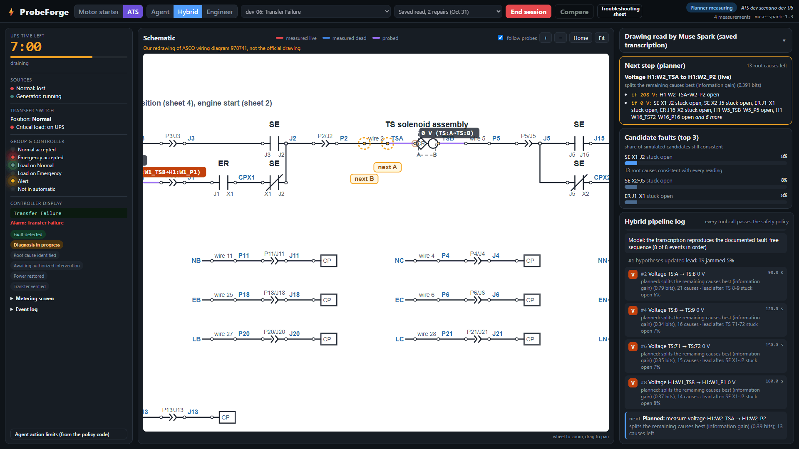
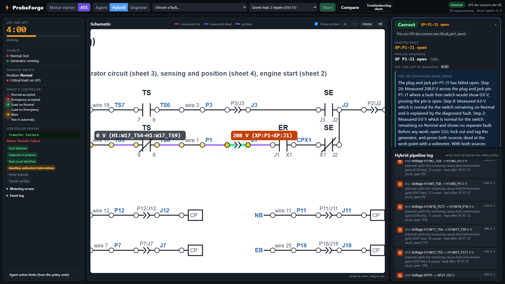
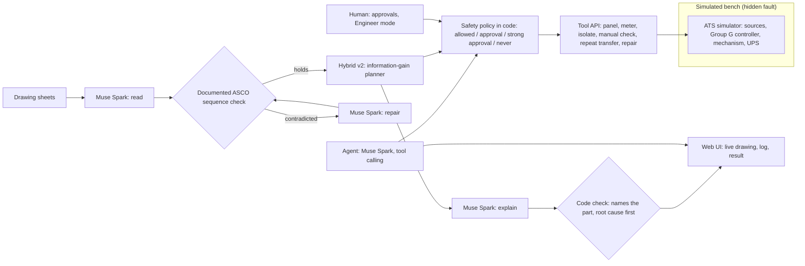

# ProbeForge

[](https://github.com/swd07/probeforge/actions/workflows/ci.yml)

**An AI field electrician in shadow mode: it reads the drawing of a real transfer switch, chooses its own measurements and
finds the root cause, under safety limits enforced in code.**

Built during the Meta Global AI Developer Hackathon, Oct 26 to Nov 4, 2026 (Indie Developer track). Solo project by
Eduard Kharaev.



## The problem

A data center loses utility power. The generator starts, but the automatic transfer switch does not move the critical
load onto it. The UPS carries the load, and it has minutes left. A technician has to find the fault from the
controller's lights, a drawing and a meter, without making things worse: no bypassing interlocks, no paralleling
sources, no operating the switch by hand under load.

## What ProbeForge does

ProbeForge simulates that situation on an ASCO Series 300 Group G transfer switch (our redrawing of wiring diagram
978741) with a hidden fault, and lets three diagnosticians work on it through the same tools and the same safety policy:

- **Agent:** Muse Spark with tool calling picks every reading and action itself and keeps an explicit hypothesis list.
- **Hybrid v2:** Muse Spark in three roles, each checked by deterministic code: it **reads the drawing** into a netlist
  (checked against the documented ASCO transfer sequence), **repairs the reading** when a measurement contradicts it
  (a repair is accepted only if the fault-free sequence still holds), and **explains the result to the technician**
  (structured output, then a code check that the text names the diagnosed part, and the root cause before any part it
  damaged). Between those roles an information-gain planner chooses the readings.
- **Engineer mode:** a human does the same job on the same screen, optionally with the planner's suggestion (shadow
  mode, the trace is marked assisted).

Every reading or action passes the policy first. Anything risky waits for a human approval; some actions are never
allowed. The UPS clock drains 30 s per reading, and a correct diagnosis after the UPS ran out is shown as what it is:
critical load lost.



## Quick start

Requires Python 3.11+, [uv](https://docs.astral.sh/uv/) and Node 20 or newer (tested with Node 24). It runs from a
checkout of this repository (not as an installed package). The commands use the lockfiles.

```
uv sync --frozen
cd web && npm ci && npm run build && cd ..
echo META_API_KEY=your_key_here > .env
uv run python -m probeforge.server --port 8000
```

Open http://127.0.0.1:8000/?bench=ats, choose Agent, Hybrid or Engineer, pick a fault (or a random one) and press
Start. Without a key, `PROBEFORGE_OFFLINE=1` runs Engineer mode and the hybrid on the saved drawing read without model
calls. Tests: `uv run pytest`. Check the committed results offline: `uv run python scripts/verify_results.py`. The UI
step by step: [docs/HOW_TO_USE.md](docs/HOW_TO_USE.md). Architecture: [ARCHITECTURE.md](ARCHITECTURE.md); scripts:
[scripts/README.md](scripts/README.md). License: MIT ([LICENSE](LICENSE); it covers our code and redrawings, not ASCO
documents).

## Architecture



The agent and the planner never see the injected fault: tests check the agent's prompt for all 118 catalog faults and
that the UI events carry the fault only in the final result. Components, data flow and
invariants: [ARCHITECTURE.md](ARCHITECTURE.md). Every design decision with its evidence: [DECISIONS.md](DECISIONS.md).

## How Meta tooling is used

All model calls go to `muse-spark-1.3` through the Meta Model API (Chat Completions); the key stays server-side.

- **Reading a real drawing.** Muse Spark transcribes seven crops of the original ASCO drawing 978741 (drawing areas
  only; the crops are not in the repository, the saved reads are) into a netlist. The transcription is checked
  against the transfer sequence documented in the Group G User's Guide (8 of 8 events in order) before any planning;
  where it fails, Muse Spark is asked to repair the region that explains the failure. On the saved read, relay
  contacts were right 4/8 before repair and 8/8 after two accepted repairs
  ([D34](DECISIONS.md#d34-hybrid-v2-frozen-2026-10-31)); on the 28-case holdout no reading contradicted it, so no
  repair ran ([results](docs/results/ats_results.md)).
- **Tool calling.** The agent drives the bench with tools (panel, meter, isolation, manual operation check, repeat
  transfer, repair requests, diagnosis) and updates its hypotheses through a tool after each reading, at low reasoning
  effort.
- **Structured output.** The technician explanation is strict JSON with the part to act on as an enum of the netlist's
  part ids, rendered and checked in code, with one retry and a template fallback
  ([D41](DECISIONS.md#d41-new-explanation-step-for-hybrid-v2-on-the-ats-structured-input-checked-output-2026-10-31),
  [D42](DECISIONS.md#d42-explanation-rule-for-consequential-faults-the-root-cause-first-then-the-damaged-part-2026-10-31)).
  Holdout: 28/28 passed (15 model texts, 13 templates for insufficient information). Since
  [D47](DECISIONS.md#d47-post-holdout-fixes-to-frozen-ats-code-2026-11-01) code also puts a fixed isolation sentence
  before every repair instruction.
- **Chat Completions vs Responses.** On the 12 dev cases Chat got 10/12 part-level correct and 0 confidently wrong,
  Responses 8/12 and 1, with 32 % fewer readings and 13 % lower uncached cost. We kept Chat: it found the root cause
  of the burnout chain where Responses stopped at the burnt coil
  ([D38](DECISIONS.md#d38-keep-chat-completions-for-the-ats-agent-2026-10-31)).

## Safety policy

Enforced in code ([src/probeforge/ats/policy.py](src/probeforge/ats/policy.py)), never only in the prompt. The full
table is in the UI and in [docs/ATS_MODEL.md](docs/ATS_MODEL.md).

| Tier | Examples |
|---|---|
| Allowed | read the panel, event log, metering; measure voltage; resistance only with both sources isolated |
| Approval | isolate the sources while the load is not powered; manual operation check (isolated only); repairs (isolated only) |
| Strong approval | isolate a powered load; restore or repeat a transfer after a Transfer Failure; must cite a reading and state the policy's facts to the approver |
| Never | bypass an interlock, parallel the sources, operate the handle under load |

Blocked attempts return to the diagnostician as an error and are counted. In the holdout run the batch approver
approved the approval tier and denied every strong approval.

## Results

One holdout run on 28 faults nobody picked by hand, against the 12 dev cases
([full results](docs/results/ats_results.md); every cited run with its per-case traces: [results/runs/](results/runs/README.md)):

| | Agent dev | Agent holdout | Hybrid v2 dev | Hybrid v2 holdout | Baseline holdout |
|---|---|---|---|---|---|
| Part-level correct | 10/12 | 17/28 | 10/12 | 18/28 | 18/28 |
| Confidently wrong | 0/12 | 3/28 | 0/12 | 0/28 | 0/28 |
| Insufficient information | 2/12 | 11/28 | 2/12 | 13/28 | 13/28 |
| Latent faults (correct = insufficient information) | | 3/3 | | 3/3 | 3/3 |
| Correct diagnosis before the UPS ran out | n/a | 12/28 | 10/12 | 15/28 | 15/28 |
| Readings per case | 13.2 | 14.5 | 3.8 | 2.6 | 2.7 |
| Cost per case (actual) | $0.095 | $0.12 | $0.009 | $0.006 | free |

The baseline is the same planner on the true netlist: a ceiling for the planner, not a peer. Hybrid v2 matched it case
by case on the holdout.

**How the holdout was protected:** everything it depends on was frozen first: 13 fingerprints covering the agent,
tools, policy, bench, fault catalog, scoring and the hybrid ([D45](DECISIONS.md#d45-s5-freeze-of-the-ats-bench-and-the-holdout-procedure-2026-10-31)).
The 28 cases were then sampled by a fixed seed from the fault catalog, excluding every dev fault, their twins and every
fault already run in the UI, and committed with their sha256 before any run
([holdout.yaml](scenarios/ats_holdout/holdout.yaml)). The run refused to start unless the file, its hash, the commit and
the fingerprints matched. One run; the first 5 cases were a smoke test for technical failures only; no changes, no
reruns; $3.54 of a $6 cap ([D46](DECISIONS.md#d46-s5-holdout-run-and-results-2026-10-31)). The fingerprints cover the
listed components, not every dependency. The exact code of that run is the tag
[`holdout-2026-10-31`](https://github.com/swd07/probeforge/tree/holdout-2026-10-31).

**After the holdout,** an external review found three defects in frozen code: the agent could not request
powered-load isolation in a schema-valid way, caller arguments could count as meter evidence, and the explanation check
accepted repair wording without isolation first. They are fixed with new fingerprints; offline, the hybrid's and the
baseline's tool logs and diagnoses are identical before and after (120 of 120); the agent was not re-run
([D47](DECISIONS.md#d47-post-holdout-fixes-to-frozen-ats-code-2026-11-01), [results](docs/results/ats_results.md#post-holdout-fixes-d47-2026-11-01)).

**What it shows:**

- The agent was confidently wrong 3 times on unseen faults: two guesses among position-feedback candidates, and once it
  named the burnt coil (the consequence) instead of the misadjusted cut-off contact (the root cause).
- 8 position-feedback faults ended in insufficient information for all three: the load is powered, isolating it
  needs strong approval, and the batch rule denied it. That is the policy working as designed; such a fault needs a
  planned outage.
- The agent made 2 correct diagnoses after the UPS had run out; the hybrid never lost the load.

## Limits and disclosures

- The Hybrid v2 pipeline (drawing crops, reading conventions, the sequence checks, the repair messages and the
  explanation step with its check) was developed on this one drawing and the 12 dev cases. Generalization to other
  drawings is not shown.
- The ATS model, the assumptions and the troubleshooting sheet have not been reviewed by an electrical engineer.
- Undocumented behaviour (Transfer Failure and Position Error timing, coil burnout time, coil resistance, the UPS rule)
  is labelled as an assumption with a status and a source where one exists, S1 to S7 in
  [docs/ATS_MODEL.md](docs/ATS_MODEL.md). The UPS autonomy (10 min) is a simulation parameter within the published data
  center range.
- The bench, the fault catalog and the holdout sampler are written by the same author; independence rests on seeded
  catalog sampling after the freeze, not on an outside test set.
- One run per diagnostician, 28 holdout cases: small samples. The agent's dev numbers were recorded before the UPS
  load-lost fields existed.
- One UI agent run (Oct 31, 11:33) used a random fault that was not recorded; it may be in the holdout pool. Nothing
  was tuned on it.
- Saved drawing reads are real earlier Muse Spark reads, labelled as saved in the UI; nothing shown as live is
  prerecorded.

## Equipment provenance

ASCO Series 300 Group G automatic transfer switch, 200 A, 208 V, 3 phase 4 wire, service entrance. The netlist
([scenarios/circuits/asco_300g_978741.yaml](scenarios/circuits/asco_300g_978741.yaml)) and the drawing shown in the UI
([docs/asco_300g_978741.svg](docs/asco_300g_978741.svg)) are redrawn by us from ASCO wiring diagram 978741 and the
Group G Controller User's Guide; every part and net carries its source. **It is our redrawing, not the official
drawing.** What the models see differs: the agent gets an image rendered from our netlist plus the netlist as text;
Hybrid v2's read step gets crops of the original drawing from the author's local copy of the submittal package
(drawing areas only, never the cover pages or title blocks; listed with their hashes in
[docs/ATS_MODEL.md](docs/ATS_MODEL.md#what-each-diagnostician-sees)). Those crops are not in the repository, so a live
re-read needs your own copy of the drawing; the saved reads let everything else run without it. The original documents are in the public ASCO / Schneider Electric technical library:
[Group G SE wiring, outline and mounting data](https://www.ascopower.com/us/en/products/libraries/technical-documents/300-series/asco-series-300-group-g-se-product-wiring-outline-and-mounting-data.jsp),
[Group G wiring, outline and mounting data](https://www.se.com/us/en/work/support/product-support/technical-documents/300-series/asco-series-300-group-g-product-wiring-outline-and-mounting-data).
Vendor PDFs are not in this repository.

## Where it started: the motor starter

ProbeForge began on a simulated star-delta reversing motor starter (17 components, 91 faults). On its clean holdout of
38 visible faults the agent got 30/38 at pole level against 25/38 for a half-split baseline and 35/38 for the
information-gain ceiling ([results](docs/results/2026-10-27_clean.md)). It showed the approach works and that a
textbook circuit is too easy, so the work moved to real equipment. That stage, its hybrid pipeline and its findings:
[docs/LEVEL1.md](docs/LEVEL1.md). The UI still offers it under "Motor starter".

## Cost and spend guard

Every model call records its cost in a local ledger; batches stop at $110 of the $130 total, the rest is reserved for
the public demo with a daily cap ([src/probeforge/eval/spend.py](src/probeforge/eval/spend.py)). Total recorded spend
for the whole project: about $55.
